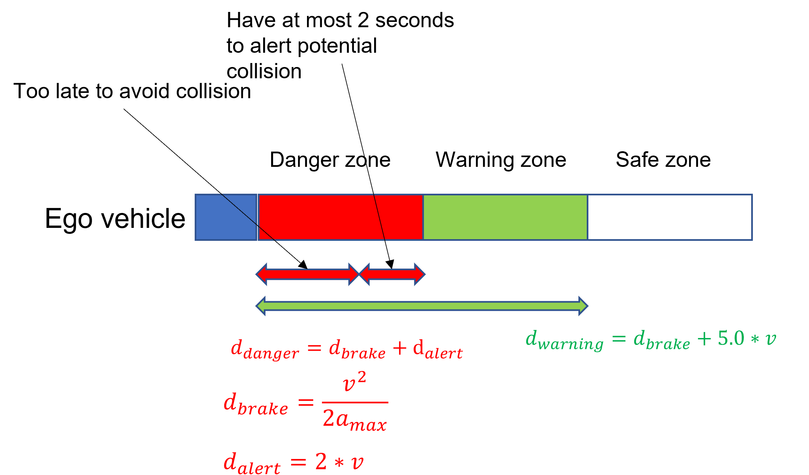

# Safety-Oriented Evaluation of Pedestrian Detection in Autonomous Driving


<details open>
<summary><strong>1. Overview</strong></summary>


### Aim

Reduce safety violations caused by image-based 2D object detection in autonomous vehicles through safety-oriented ensemble design.

### Research Problems

1. Identify factors associated with pedestrian detection failures that correlate with safety violations.
2. Design ensemble models targeting these factors to reduce safety violations.

To investigate these problems, the project compares individual object detectors and ensemble methods using conventional vision metrics and safety-related metrics, across real-world driving data and simulation scenarios.


</details>

<details open>
<summary><strong> 2. Experimental Design</strong></summary>


### 2.1 Datasets

| Dataset | Description |
|---------|-------------|
| nuScenes | Real-world autonomous driving dataset with multi-camera image sequences and 3D annotations |
| CARLA | Autonomous driving simulation platform used to generate pedestrian detection scenarios and evaluate safety-related performance |

**Task:** Pedestrian detection in image sequences.

**Input:** Camera images from autonomous driving scenarios.

**Output:** Pedestrian bounding boxes, detection confidence scores, and frame-level detection results.


### 2.2 Methods

The evaluated methods are organized into two categories.

#### Type 1: Individual Model


#### Type 2: Ensemble Methods


[//]: # (Methods that combine multiple detection models to improve detection performance and reliability.)

[//]: # ()
[//]: # (Examples:)

[//]: # (- Voting-based ensembles)

[//]: # (- Confidence-based fusion)

[//]: # (- Adaptive ensemble methods)

### 2.3 Evaluation Metrics

The project evaluates detection performance using both conventional vision metrics and safety-related metrics. Safety-related results are reported separately for **Type 2 (warning-zone)** and **Type 3 (danger-zone)** pedestrians, in addition to overall results.

#### A. Vision Metrics

- AP@0.5, AP@0.75, and AP@0.5:0.95
- Precision, Recall, and F1 score
- Average Recall (AR)

Since the current detection task contains only the pedestrian class, multi-class mAP is not a separate focus.

#### B. Safety-Related Metrics

- **Detection before the critical transition:** whether a Type 2 pedestrian is successfully detected before entering Type 3.
- **Type 3 missed detections:** the number or rate of missed pedestrians on danger-zone frames.
- **First-appearance detection:** whether a pedestrian already in Type 3 at first appearance is detected on that frame.
- **Late initial detection (diagnostic):** the number of frames between a pedestrian's first appearance and first successful detection. This supports analysis but does **not** independently define a safety violation.
- **False positives per image:** a proposed target is recorded in Section 3.3; its exact operational definition still needs to be fixed.

A consecutive-five-frame missed-detection rule appears in the related-work discussion but is **not an active requirement** in the current study.


</details>

<details open>
<summary><strong>3. Safety Requirements</strong></summary>


### 3.1 Distance-Based Danger, Warning, and Safe Zones


Let:

- `v` be the ego-vehicle speed in **m/s**;
- `d` be the pedestrian's distance in front of the ego vehicle, in **m**;
- `a_max = 8 m/s²` be the assumed magnitude of maximum braking deceleration;
- `d_brake` be the stopping distance under maximum deceleration;
- `d_alert` be the distance traveled during a **2 s** alert interval.

The current boundaries are:

```text
d_brake   = v² / (2 × a_max)
d_alert   = 2 × v
d_danger  = d_brake + d_alert
d_warning = d_brake + 5 × v
```



All formulas require `v` in m/s; convert from km/h by dividing by 3.6. These distances omit additional perception/actuation delay and safety margins in the current setup.

| Zone | Distance condition | Interpretation |
|------|--------------------|----------------|
| **Danger — stopping no longer feasible under the assumed braking model** | `0 < d ≤ d_brake` | A collision cannot be avoided by initiating maximum braking at this point under the stated assumptions. |
| **Danger — braking still possible** | `d_brake < d ≤ d_danger` | Up to approximately 2 s of extra distance at the current speed beyond the braking distance is available for warning/intervention. |
| **Warning** | `d_danger < d ≤ d_warning` | The pedestrian is relevant; detection should occur before the danger zone is reached. |
| **Safe** | `d > d_warning` | The pedestrian is outside the current safety-relevant distance range. |

The region ahead of the ego vehicle is divided into three zones according to stopping-distance-based boundaries.

[//]: # (Safety relevance is currently determined using the pedestrian's distance in front of the ego vehicle and vehicle-speed-dependent braking boundaries &#40;Section 3.1&#41;. The current zone labels are **distance-based**, rather than being assigned using a fixed TTC threshold.)

Each pedestrian instance is assigned one of four frame-level labels:

| Label | Zone / State | Meaning |
|-------|--------------|---------|
| **0** | Absent | The pedestrian does not appear in the frame. |
| **1** | Safe zone | The pedestrian appears but is not relevant to the current safety evaluation. |
| **2** | Warning zone | A relevant pedestrian who is not yet in the danger zone. |
| **3** | Danger zone | A pedestrian in the safety-critical distance range. |

Types 2 and 3 are the principal subjects of the safety-oriented evaluation. An overall detection evaluation can still include Type 1 pedestrians and should clearly state its evaluation population.

**Distance boundaries by ego-vehicle speed:**

| Speed | Danger: `0 < d ≤ d_brake` | Danger: `d_brake < d ≤ d_danger` | Warning: `d_danger < d ≤ d_warning` | Safe: `d > d_warning` |
|-------|--------------------------|--------------------------------|--------------------------------------|-----------------------|
| **20 km/h** | 0–1.93 m | 1.93–13.04 m | 13.04–29.71 m | > 29.71 m |
| **40 km/h** | 0–7.72 m | 7.72–29.94 m | 29.94–63.27 m | > 63.27 m |
| **60 km/h** | 0–17.36 m | 17.36–50.69 m | 50.69–100.69 m | > 100.69 m |

The danger zone is **not synonymous with unavoidable collision**: only its inner subregion (`d ≤ d_brake`) is described as non-stoppable under these assumptions. A pedestrian anywhere in the danger zone receives **Label 3**; a pedestrian in the warning zone receives **Label 2**.

### 3.2 Braking Deceleration Assumptions

The working values for this experiment are:

| Parameter | Value | Role |
|-----------|-------|------|
| Maximum braking deceleration (`a_max`) | **8 m/s²** | Used to calculate `d_brake` and both zone boundaries above. |
| Comfort braking deceleration | **3 m/s²** | Recorded as a separate assumption; **not** used for the current zone-boundary table. |

The boundary table assumes constant ego speed before braking and constant maximum deceleration during braking. Other road conditions may yield different effective decelerations and therefore different boundaries; the current table should not be treated as universal stopping-distance limits.

### 3.3 Perception Safety Requirements

**Primary requirement — detection before danger:** The perception system should establish the existence of a relevant pedestrian while the pedestrian is in **Type 2**, before that pedestrian becomes **Type 3**. If a pedestrian is already Type 3 on their first observed frame, the detector should identify the pedestrian **on that first frame**.

| ID | Scope | Requirement or evaluation rule | Status |
|----|-------|--------------------------------|--------|
| **SR-01** | Type 2 → Type 3 | Detect the pedestrian before its first transition into Type 3. | Primary safety requirement |
| **SR-02** | First observed as Type 3 | Detect the pedestrian on its first appearance frame. | Primary safety requirement |
| **SR-03** | Type 3 | The model should not miss the pedestrian on any Type 3 frame. | Per-frame safety requirement |
| **SR-04** | Type 2 | Record whether the pedestrian has been detected at least once before the distance reaches `d_brake`. | Baseline metric, weaker than SR-01 |
| **SR-05** | All relevant pedestrians | An incorrect class prediction (e.g., pedestrian classified as bicycle) counts as a missed pedestrian detection. | Evaluation rule |
| **SR-06** | False positives | Proposed target: **no more than 0.1% per image**, as stated in the source document. | Provisional; denominator/units require specification |

**Supporting analysis (not standalone violations):** Measure late initial detection as the frame interval between first appearance and first successful detection. Analyze its relationship to the transition into Type 3.

**Not adopted at this stage:** The proposed five-consecutive-frame sliding-window missed-detection rule is explicitly set aside in the source document. Do not automatically treat sliding-window misses as safety violations in the current evaluation.

**Interpretation cautions:**

- SR-01 and SR-04 are deliberately distinguished. Detecting someone before `d ≤ d_brake` is a weaker baseline than detecting them **before they enter the danger zone** (`d ≤ d_danger`).
- The source writes the false-positive target as “0.1% per image.” Because false positives per image (FPPI) is normally a *count per image*, the threshold needs an explicit counting/normalization definition before it can be implemented or judged.
- These are **perception-level** requirements. Meeting or violating a frame-level detection condition does not, by itself, prove that a collision will or will not occur in a closed-loop system.

[//]: # (## 4. Experimental Workflow)

[//]: # ()
[//]: # (1. **Data Preparation**)

[//]: # (   - Load image sequences and pedestrian annotations.)

[//]: # (   - Identify pedestrian instances across frames.)

[//]: # (   - Generate or load safety-critical annotations.)

[//]: # ()
[//]: # (2. **Model Inference**)

[//]: # (   - Run individual object detectors.)

[//]: # (   - Apply individual model improvement methods.)

[//]: # (   - Apply ensemble methods.)

[//]: # (   - Store detection results.)

[//]: # ()
[//]: # (3. **Performance Evaluation**)

[//]: # (   - Match predictions with ground-truth annotations.)

[//]: # (   - Calculate conventional vision metrics.)

[//]: # (   - Calculate safety-related metrics.)

[//]: # ()
[//]: # (4. **Comparative Analysis**)

[//]: # (   - Compare different individual models.)

[//]: # (   - Compare individual model improvements with ensemble methods.)

[//]: # (   - Analyze differences between vision and safety-related performance.)

[//]: # (   - Investigate temporal patterns of detection failures.)


</details>

<details open>
<summary><strong>4. Experimental Results</strong></summary>


Preliminary experiments were conducted on the nuScenes-mini dataset and the CARLA simulation platform using three pretrained object detection models: Mask R-CNN, Cascade Mask R-CNN, and HTC.

### 4.1 Pedestrian Detection Performance

The models were evaluated using AP@0.5, with results reported separately for all pedestrians (Overall), Type 2 pedestrians (Warning Zone), and Type 3 pedestrians (Danger Zone).

| Dataset | Model | Overall | Type 2 | Type 3 |
|---------|-------|---------|--------|--------|
| nuScenes-mini | Mask R-CNN | 0.430 | 0.460 | 0.490 |
| nuScenes-mini | Cascade Mask R-CNN | 0.400 | 0.440 | 0.460 |
| nuScenes-mini | HTC | 0.400 | 0.430 | 0.470 |
| CARLA | Mask R-CNN | 0.674 | 0.559 | 0.993 |
| CARLA | Cascade Mask R-CNN | 0.719 | 0.635 | 0.994 |
| CARLA | HTC | 0.737 | 0.669 | 0.993 |

**Metric:** AP@0.5 (IoU threshold = 0.5).

### 4.2 Preliminary Observations

- All three models achieve higher AP@0.5 for Type 3 pedestrians than for Type 2 pedestrians on both nuScenes-mini and CARLA.
- Mask R-CNN achieves the highest overall AP@0.5 on nuScenes-mini, whereas HTC performs best overall on CARLA.
- The models show substantially higher AP@0.5 on CARLA than on nuScenes-mini, particularly for Type 3 pedestrians.
- The comparatively higher performance on CARLA may be related to the simpler simulation scenarios, which currently contain a single pedestrian per image without occlusion.
- Future experiments will introduce more challenging simulation conditions, including multiple pedestrians and occlusions, to further investigate detection failures.


</details>

[//]: # (<details open>)

[//]: # (<summary><strong>6. Research Directions</strong></summary>)

[//]: # ()
[//]: # ()
[//]: # (### Direction 2: Factors Associated with Safety-Related Detection Failures)

[//]: # ()
[//]: # (Identify factors contributing to pedestrian detection failures that correlate with safety violations, including when and under which conditions the failures occur.)

[//]: # ()
[//]: # (### Direction 3: Safety-Oriented Ensemble Design)

[//]: # ()
[//]: # (Design ensemble models that explicitly target the identified failure factors and evaluate whether they reduce safety violations.)

[//]: # (</details>)

<details open>
<summary><strong>7. Status</strong></summary>


**Current state:** Preliminary evaluation criteria and scenarios have been established.

- **Safety-critical pedestrian classification:** Defined four pedestrian labels (0–3) using speed-dependent danger, warning, and safe zones.
- **Evaluation metrics:** Identified conventional vision metrics and safety-related detection requirements/metrics for Type 2 and Type 3 pedestrians.
- **Evaluation environments:** Selected nuScenes-mini as the real-world dataset and CARLA as the simulation platform; designed a simulation scenario involving a pedestrian crossing and an ego vehicle that must brake to avoid collision.
- **Preliminary results:** Evaluated Mask R-CNN, Cascade Mask R-CNN, and HTC on nuScenes-mini and CARLA (Section 5).

**Next focus:** Analyze safety-related failure factors and use the findings to guide ensemble design.


</details>
